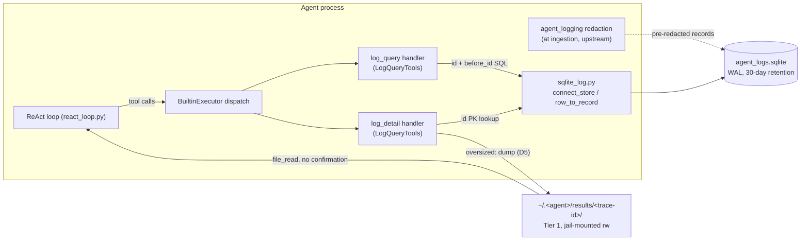
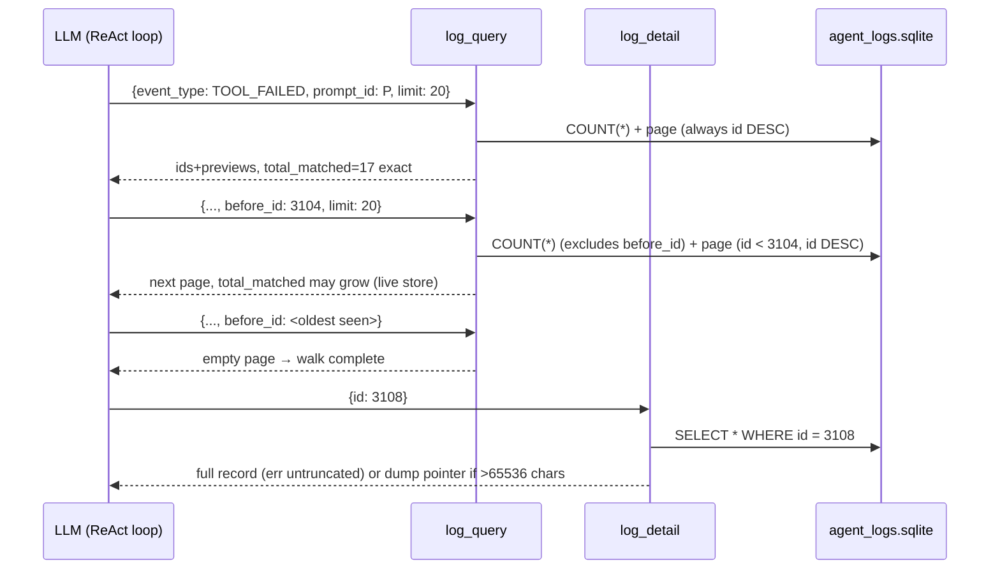

# Design — add-log-detail-tool

## Context

The structured log store (`agent_logs.sqlite`, ADR-0025) is the agent's only
self-observable history. `log_query` reads it with indexed SQL filters, but
three properties of the read path (verified in `builtin_tools/secrets_log.py`
and `builtin_tools/logquery_helpers.py`) block per-failure root-cause analysis
on long runs: per-field truncation at 500 chars, the per-call output budget
(`agent.max_output_size`, default 4000), and the lack of any enumeration
mechanism ("newest N that fit" only). The store schema already has an
`INTEGER PRIMARY KEY id` on `events`; the change is confined to the read path
and the tool registry — no storage, ingestion, or retention changes.

In-force ADRs that constrain this design: ADR-0004 (structlog backbone,
redaction at ingestion, closed taxonomy — untouched), ADR-0008 (builtin tool
logic lives in `builtin_tools/` subpackage, executor is a dispatcher — new
handler follows this), ADR-0025 (store + `log_query` query mechanism — this
change extends the filter surface within the boundary that ADR explicitly
owns), ADR-0026 (PathPolicy tiers — dump destination is Tier 1), ADR-0028
(agent dot-home: `~/.<agent>/results/` is the artifact exchange surface).
ADR-0017 (session-logs jail mount) is superseded by ADR-0028 and imposes no
constraint here.

## Goals / Non-Goals

**Goals**
- Every log record is referenceable (`id`) and enumerable (`before_id` walk),
  newest→oldest, without cursor state, correct while the store is appending.
- One record is readable at full fidelity (`log_detail`), within a 65536-char
  hard cap; oversized records dump to `~/.<agent>/results/<trace-id>/` with a
  pointer + preview returned.
- `log_query` defaults preserved; one refinement: the page query is always
  ordered by `id` so `before_id` walks are gapless under both truncation
  paths (count and output-size); for single-page untrimmed results the two
  orders are indistinguishable in practice (sub-second emit-vs-drain skew).

**Non-Goals**
- Aggregations / `group_by` (rejected in exploration — counts don't expose
  failure nature; `total_matched` COUNT-probe covers triage).
- A `detail: true` flag on `log_query` (rejected — a wide filter + full
  fidelity degrades to 1–2 records against the per-call budget; the separate
  tool forces an explicit per-record decision).
- OFFSET/position paging (rejected — O(n²) scan-and-discard; corrupts under
  concurrent appends).
- Raising default `max_output_size` or changing Option C defaults.
- Any write path, retention, or schema change to the store.

## Decisions

### D1 — `id` exposure lives in `row_to_record` (`sqlite_log.py`)

`row_to_record()` is the single row→record contract shared by all readers.
Adding `id` there gives `log_query` and `log_detail` the same reference field
with one change and keeps the two tools' records identical in shape (wide
columns + parsed `extra` merged at top level — the frozen spec's identity
scenario pins `log_detail` output to this exact projection).
*Alternative:* handler-level injection — rejected: two call sites, drift risk.

### D2 — `before_id` is a filter part with walk-specific ordering and COUNT semantics

`LogQueryFilters` gains `before_id`; `_log_query_compile_where` emits
`id < ?` (PK range scan, composes with all existing parts, sargable). Three
deliberate semantics, all required by the frozen spec:

- **COUNT excludes `before_id`.** `total_matched` stays the exact count of the
  *entire* match set (120 for every page of the walk scenario). If COUNT
  included `before_id`, each page would report a different number and the
  agent could never know the full set size. On a live (still-appending)
  store, the whole-set count can *grow* while the walk proceeds — new rows
  get higher ids and are outside every `id < before_id` page by construction.
  Therefore: **walk completion is exhaustion-based — a page that returns no
  records ends the walk.** `total_matched` is a set-size signal, never a
  completion signal; "cumulative retrieved == total_matched" is explicitly
  wrong mid-run (it can never fire on a growing match set). To guard against
  a malformed `before_id` silently re-reading page 1, the handler validates
  that every returned id is `< before_id` when the filter was applied
  (defensive assertion; a violation would surface the anchor failure rather
  than treat it as progress).
- **The page query is always ordered by `id DESC`.** `ts` is stamped at
  emit time (producer threads: main, sub-agents, scheduler) while `id` is
  assigned at drain time (single writer queue batched INSERTs), so the two
  orders can invert under concurrency. A page in `ts` order can carry a
  non-prefix id-set, and its `min(id)` would then cut off records with
  older `ts` from every subsequent `id <` page — a silent gap, violating
  the spec's exactly-once walk guarantee. The ordering therefore must not
  be gated on which truncation path fires: the per-call output-size trim
  (`max_output`, applied in `_log_query_result` after the SQL sort) is
  unknowable at query-build time, and the motivating workload — a handful
  of verbose failure records under `limit`, count-untruncated but
  size-trimmed — would silently fall back to `ts` order under a
  count-based trigger. Always `ORDER BY id DESC` (re-ascended by `id` for
  output) closes both paths with one rule. Nothing observable is lost:
  emit-vs-drain skew is sub-second, so for results that fit one page
  untrimmed the two orders are indistinguishable in practice.
- **Invalid/absent `before_id`** (None, non-int) → filter omitted, mirroring
  the graceful `limit` fallback. JSON `null` treated as unset (LLM
  emitters).

### D3 — `log_detail` handler lives in `LogQueryTools` (`builtin_tools/secrets_log.py`)

`_exec_log_detail(args, caller_depth=0, caller_tag="")` beside
`_exec_log_query`, per ADR-0008. Dispatch entry in `builtin_executor.py`
routes `"log_detail"` by name, same as peers. Read-only, not
confirmation-capable. Flow: resolve `id` (int; invalid → EMPTY result) →
`connect_store` (failure → EMPTY result) → `SELECT * FROM events WHERE id = ?`
(PK lookup) → `row_to_record` → serialize (compact JSON, `ensure_ascii=False`)
→ size gate.

Payload shapes (peer result-dict convention):
- found: `{"found": true, "record": {...}, "dumped": false, "dump_path": null}`
- oversized: `{"found": true, "record": <preview projection>, "dumped": true, "dump_path": "..."}`
- not-found / unreadable store: `{"found": false, "record": null, "dumped": false, "dump_path": null}`

### D4 — Size gate: 65536 chars on the serialized record; preview = existing 500-char projection

The gate measures the serialized *record* (not the payload wrapper) in chars,
per the frozen spec. Below the gate: full record, no per-field truncation —
`_log_query_project` is *not* applied. Above: the returned `record` is the
500-char-projected preview (reuse `_log_query_project` — one truncation
mechanism, two call sites) and the full record goes to the dump (D5).
*Alternative:* a larger bespoke preview length — rejected: reuse beats
tuning; the dump pointer is the real escape hatch.

### D5 — Dump reuses the `_finalize_shell_log` relocation pattern

Write `log-detail-<id>.json` under `results_dir/<trace-id>/` replicating the
`_finalize_shell_log` mechanics (0o700, collision counter, `os.replace`,
redaction pass). The handler *creates* the dump from an in-memory record — it
cannot literally call `_finalize_shell_log` (which relocates an
already-written artifact); the implementer's call: extract a shared
relocation/collision/redaction helper vs replicate the mechanics inline.
Either is acceptable; what is NOT acceptable is a redaction pass weaker than
the shell path's. If the dump replicates the shell path's redaction, its 10 MB
size guard is irrelevant here (records are ingestion-redacted, well under
10 MB). Trace selection: the **record's own `trace`**, falling back to the
current run's contextvars trace — per the frozen spec's no-trace scenario —
with one safety refinement: stored record content is untrusted as a path
component, so the record's `trace` is **validated against the trace-id
format (`r-[0-9a-f]{8}`)** before use as a subdirectory name; a missing or
non-conforming trace falls back to the current run's trace. The resolved
dump path is asserted to remain within `results_dir` (containment check
before the write). Redaction: records are already vault-redacted at
ingestion (`agent_logging`); the dump applies the same redaction pass anyway
(idempotent, defense-in-depth, and required by the spec anchor: MUST NOT
reduce existing redaction). Degradation: if `results_dir` is unset or the
write fails, return the preview-projected record with a note in the payload —
well-formed, never an error.

### D6 — Registry, schema, prompt docs

- `builtin_tools/descriptors.py`: `log_detail` entry (args: `id` required;
  describes full-fidelity read, cap, dump behavior); `log_query` descriptor
  updated with `before_id`, the `limit` × output-budget interplay, the
  COUNT-probe pattern, walk-then-drill, and walk-scoping discipline
  (exhaustion-based completion; scope exhaustive walks by `prompt_id` or
  explicit `trace`; warn that `text`-only queries auto-widen to all traces
  over the full retention window) — all mandated by the frozen
  descriptor-docs requirement.
- `builtin_tools/schemas.py`: `log_detail` JSON-schema entry `{id: int}`,
  required `["id"]`; `log_query` gains optional `before_id` (integer).
- `prompts/system/03-capabilities.md` + `prompts/sub-agent/03-tools.md`: add
  `log_detail`, note `before_id` on `log_query`.

### D7 — Tests mirror the spec scenarios

`test_log_query.py` (id, before_id paging incl. constant `total_matched`,
walk-while-appending, **ts/id-order inversion across a page boundary — under
both truncation paths: count-split and `max_output` size-trim**,
composition with filters, invalid-value fallback, exhaustion-based
completion);
- `test_log_detail.py` (full-fidelity >500-char `err` verbatim, identity vs
  `log_query` preview, not-found EMPTY, unreadable-store EMPTY, oversized dump
  + pointer + preview, no-trace → current-trace, **malformed stored trace →
  current-trace fallback + no directory from the malformed value**,
  **redaction preserved in the dumped artifact**, dump-failure degradation);
- `test_descriptors.py`-style content assertions for the two frozen
  descriptor-docs scenarios: the `log_query` descriptor states the
  output-budget interplay (raising `limit` alone doesn't return more), the
  `limit: 1` COUNT-probe, and walk-then-drill (`before_id` + `log_detail`)
  — substring assertions over the registry text;
`test_builtin_dispatch_routing.py` list grows to 23; `test_prompt_loader.py`
tool lists updated. `vulture_whitelist.py` only if new public symbols get
flagged.

## C4 diagrams (lightweight)

### Container — log read path after the change

- Two read-only handlers share one store contract (`sqlite_log.py`); neither
  writes to the store.
- The only new write surface is the oversized dump into the existing
  results-dir convention — the same destination the loop already reads back
  from without confirmation.
- Redaction happens at ingestion (upstream, unchanged); the dump preserves it.

### Dynamic — walk-then-drill sequence

- The COUNT on every page reports the whole-set size; the walk ends on an
  empty page (exhaustion), never on count comparison (D2).
- `log_detail` is entered only by explicit id — the per-record decision that
  motivated the split.

## Risks / Trade-offs

- [New `id` field changes `log_query` record dicts] -> assert-based tests and
  prompt-loader lists are updated in the same change (D7); field is additive,
  no consumer narrows on exact dict equality except tests we own.
- [COUNT/page split (`before_id` excluded from COUNT) is subtle] -> explicit
  in D2 and pinned by the constant-`total_matched` test; an implementer
  skimming "composes with all filters" could otherwise put it in both queries.
- [A near-cap record (~65KB) still costs ~16x a default `log_query` payload]
  -> accepted: the agent opted into that specific record; the cap bounds the
  worst case, and the split keeps this off the list path entirely.
- [Dump write fails or `results_dir` unset] -> well-formed degraded result
  with preview + note (D5), never an error; mirrors the EMPTY convention.
- [Silent `before_id` omission re-reads page 1] -> unlike `limit`, an
  invalid/absent `before_id` yields the *newest* page again. Mitigation:
  walk completion is exhaustion-based (empty page ends the walk — never
  count-comparison against `total_matched`, which grows on a live store),
  and the handler validates that every returned id is `< before_id` when
  the filter was applied, so an unapplied anchor surfaces instead of
  masquerading as progress; D6's integer-typed schema makes provider-side
  coercion likely.
- [`id`-order vs `ts`-order divergence under concurrency] -> emit-time `ts`
  and drain-order `id` can invert; the page query is always ordered by `id`
  so `before_id` pages cannot skip records under either truncation path —
  count and output-size (D2).
- [A near-cap `log_detail` result can trip auto-compaction] -> a ~65KB
  record returns ~16× a default `log_query` payload in one tool result and
  may push the context past the `context_manager` compaction threshold
  (85%), evicting the very context under analysis. Mitigation: the agent
  opted into that specific record; the cap bounds the worst case, and the
  dump-then-`file_read` path exists for records that should be paged
  (`file_read` offset/max_bytes) instead of inlined.

## Migration Plan

None required. No schema, config, dependency, or ingestion changes; `id`
already exists as the row PK. Deployment is code-only and additive; rollback
is revert. Old persisted tool-schema snapshots refresh via the existing
tool-defs snapshot mechanism on next run.

## Open Questions

- None blocking. ADR-0025's boundary explicitly covers the `log_query` query
  mechanism, so no in-force ADR is revisited; the ADR step will record the
  list-detail split as a new decision (related-to, not superseding, ADR-0025).