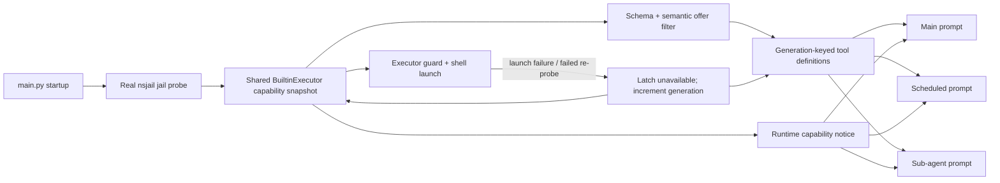

## Context

The current default and fallback paths in `config_schema.py`/`builtin_executor.py` permit host subprocess or PTY execution when nsjail is not active. The change makes nsjail the default but treats confinement as an availability condition, not a reason to stop the agent: no host-shell path may be selected, including after startup loss. One shared `BuiltinExecutor` is the runtime capability owner for main, scheduled, and sub-agent prompt executions. Its immutable capability value is replaced atomically when state changes; it carries `available`, an actionable `reason`, and a monotonically increasing `generation`.

The 33-file ADR inventory was reviewed. ADR-0012 (nsjail isolation with subprocess fallback) is currently in force and conflicts with this policy; leave it unchanged and record a partial supersession in the later ADR step. ADR-0026's frozen `PathPolicy` and ADR-0027's sink-side `GrantLedger` vetoes remain in force. ADR-0015 also applies: capability/probe state that influences jail execution must not be stored in a sandbox-writable location. ADR-0007 keeps agent construction at `AgentRuntime`; ADR-0009 requires native and JSON dispatch paths to remain coherent.

## Goals / Non-Goals

**Goals:** Ensure shell and its companion `shell_env_set`, `shell_env_unset`, `shell_env_list`, and `shell_env_get` tools are offered/executable only with healthy Linux nsjail. Hide them from callable definitions, semantic search, and prompts when unavailable; return a nonrecoverable actionable `shell_unavailable` for stale calls. Keep the agent and unrelated tools operational, notify every prompt type of current capability, and never fall back to host subprocess/PTY.

**Non-Goals:** A job-level `requires_shell` flag or schedule permission changes; deterministic scheduled failure status, `last_error`, or notification changes (ARCH-03 is separate); enabling shell on macOS; an unsafe opt-in; changing path access or confirmation grant policy; adding dependencies.

## Decisions

1. **Capability owner and lifecycle.** The shared `BuiltinExecutor` owns the atomic immutable snapshot. Startup sets it available only after a real nsjail jail probe succeeds on Linux; default `shell_backend` becomes `nsjail`. Explicit `subprocess`/`pty`, non-Linux, missing binary, invalid jail setup, or failed probe produce unavailable capability with a reason, but do not fail agent startup. Runtime nsjail launch failure or failed re-probe latches unavailable until process restart and increments generation once. Do not probe/classify command exit codes as backend health: nonzero exits and command timeouts remain ordinary results. Alternatives: process-fatal startup (rejected because non-shell work must continue); binary-presence-only probing (rejected because it does not demonstrate a usable jail); automatic recovery/re-enable (rejected to avoid races and uncertain offers; restart is the recovery boundary).

2. **No unconfined execution path.** Every shell-family execution checks the current snapshot immediately before execution. Capability loss prevents future launches, never dispatches to subprocess or PTY, and blocks both direct and previously staged confirmation execution. Resolve the final check/start race so a queued call cannot start host execution after loss; do not represent backend loss as a command exit. Preserve active nsjail confirmation modes only while the jail is active; unavailable capability rejects regardless of confirmation setting. Alternatives: retain fallback but require confirmation (rejected—confirmation is not confinement); silently make configured host backends work (rejected by the security boundary).

3. **Filter offers by capability generation.** The shared owner supplies one capability snapshot to main, scheduled, and sub-agent runs. When unavailable, filter the complete shell family from `builtin_tools/schemas.py` callable schemas, semantic discovery/indexing, and runtime prompts. Built-in names remain reserved in dispatch/registration so an MCP tool cannot shadow shell names when hidden. When available, preserve current backend and depth-specific policies (including sub-agent shell fail-closed behavior). `react_loop.py` reuses native tool definitions only while their recorded generation matches; on mismatch it rebuilds before the next LLM request. The executor is authoritative regardless of model freshness, including JSON-mode calls and in-flight native calls. Alternatives: restart the whole agent or leave cached offers until the next prompt (rejected because the agent must remain available and stale offers must not enable execution).

4. **Runtime notice, not static platform claims.** Assemble an explicit availability/unavailability notice from the same snapshot for main, scheduled, and sub-agent prompts. State that shell is unavailable and give the operator-facing remediation when unavailable; do not claim macOS support or infer availability from config alone. A stale invocation returns nonrecoverable `shell_unavailable`, explaining that shell requires healthy Linux nsjail and suggesting operator installation/repair followed by restart. Tool environments are session-scoped; do not persist a stale shell offer across capability generations.

5. **Scheduled semantics remain prompt semantics.** Scheduled runs receive the same notice and dispatch guard; there is no job permission bit or requirement flag. If a prompt responds that it cannot use shell without invoking the tool, existing scheduler behavior may record success. This is an accepted limitation until separate ARCH-03 work; do not add `last_error` or notification promises here.

## Risks / Trade-offs

- [A probe falsely reports a usable jail] -> Probe with a real harmless jailed invocation and validate its completion/exit contract; retain the executor guard and fail closed on probe errors.
- [A runtime launch failure is misclassified or ordinary command failures disable shell] -> Classify backend-launch/probe failures separately from child exit status and timeout; test both branches.
- [Stale cached or staged call races capability loss] -> Generation-check tool definitions before every LLM request; recheck capability at dispatch and confirmation execution; serialize loss latch and launch admission.
- [Default change surprises operators or removes shell on macOS/misconfigured Linux] -> Update `config.toml.example`, README and nsjail setup guidance, surface actionable startup status/logging, and keep other tools available.
- [Historical native/JSON calls or provider behavior differ from refreshed offers] -> Treat historical-call compatibility as unverified; exercise native and JSON paths, including cached/in-flight calls, in integration tests.
- [Scheduled prompt appears successful despite absent shell] -> Document the known limitation; do not imply deterministic run failure. Defer generic outcome correction to ARCH-03.
- [nsjail failure surfaces as a command error and host fallback is reintroduced] -> Keep the failure class nonrecoverable and prohibit host backends in all paths, including confirmation retries and explicit backend config.

## Migration Plan

Change the default to `nsjail`; update sample configuration and operator docs to remove instructions implying subprocess/PTY are safe fallbacks. Existing explicit `subprocess`/`pty` configurations remain parseable but no longer enable model-issued shell; operators must install/configure working Linux nsjail to restore shell. Validate with focused unit tests for config/capability, dispatch, generations, stale/staged calls, and prompt filtering; integration tests for main/scheduled/sub-agent shared capability and native plus JSON dispatch; Linux nsjail VM smoke tests for real probe, successful command, backend loss, and no host fallback; macOS tests asserting shell is unavailable and non-shell tools continue. Roll back by disabling shell and continuing with non-shell tools, or reverting the release only if the security boundary can remain fail-closed; never roll back by restoring host fallback. No state migration is required.

## Open Questions

- What exact harmless command and validation criteria define a successful startup jail probe across supported Linux distributions and nsjail versions?
- Which runtime launch/probe failures are reliable evidence of backend loss, and how can health be checked without treating ordinary child status/timeout as loss?
- What synchronization boundary guarantees that loss latching and an admitted nsjail launch are ordered, including an already-running jailed command?
- ADR-0012 must be partially superseded to remove the subprocess fallback commitment and establish default/fail-closed availability; leave that ADR untouched until the ADR workflow.
