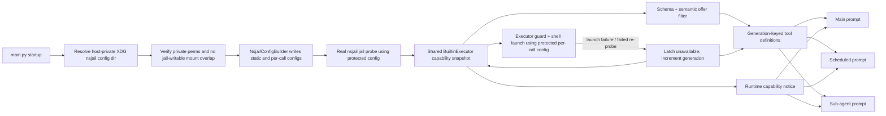

## Context

The current default and fallback paths in `config_schema.py`/`builtin_executor.py` permit host subprocess or PTY execution when nsjail is not active. The change makes nsjail the default but treats confinement as an availability condition, not a reason to stop the agent: no host-shell path may be selected, including after startup loss. One shared `BuiltinExecutor` is the runtime capability owner for main, scheduled, and sub-agent prompt executions. Its immutable capability value is replaced atomically when state changes; it carries `available`, an actionable `reason`, and a monotonically increasing `generation`.

The 33-file ADR inventory was reviewed. ADR-0012 (nsjail isolation with subprocess fallback) is currently in force and conflicts with this policy; leave it unchanged and record a partial supersession in the later ADR step. ADR-0026's frozen `PathPolicy` and ADR-0027's sink-side `GrantLedger` vetoes remain in force. ADR-0015 also applies: capability/probe state and generated static or per-call nsjail configuration that influences jail execution must not be stored in a sandbox-writable location. These configs and the supervisor diagnostic logs used as trusted backend evidence are security-sensitive host state, not session scratch: neither the host session tmpdir mounted as `/tmp` nor the agent handoff dir mounted at `/tmp/<agent>` is suitable. ADR-0007 keeps agent construction at `AgentRuntime`; ADR-0009 requires native and JSON dispatch paths to remain coherent.

## Goals / Non-Goals

**Goals:** Ensure shell and its companion `shell_env_set`, `shell_env_unset`, `shell_env_list`, and `shell_env_get` tools are offered/executable only with healthy Linux nsjail. Hide them from callable definitions, semantic search, and prompts when unavailable; return a nonrecoverable actionable `shell_unavailable` for stale calls. Keep the agent and unrelated tools operational, notify every prompt type of current capability, and never fall back to host subprocess/PTY.

**Non-Goals:** A job-level `requires_shell` flag or schedule permission changes; deterministic scheduled failure status, `last_error`, or notification changes (ARCH-03 is separate); enabling shell on macOS; an unsafe opt-in; changing path access or confirmation grant policy; adding dependencies.

## Decisions

1. **Capability owner and lifecycle.** The shared `BuiltinExecutor` owns the atomic immutable snapshot. Startup sets it available only after a real nsjail jail probe succeeds on Linux; default `shell_backend` becomes `nsjail`. Explicit `subprocess`/`pty`, non-Linux, missing binary, invalid jail setup, or failed probe produce unavailable capability with a reason, but do not fail agent startup. Runtime nsjail launch failure or failed re-probe latches unavailable until process restart and increments generation once. Do not probe/classify command exit codes as backend health: nonzero exits and command timeouts remain ordinary results. Alternatives: process-fatal startup (rejected because non-shell work must continue); binary-presence-only probing (rejected because it does not demonstrate a usable jail); automatic recovery/re-enable (rejected to avoid races and uncertain offers; restart is the recovery boundary).

2. **Host-private nsjail configuration and diagnostic state.** Resolve a dedicated host-private config directory beneath the already agent-scoped `state_home` (for example, `$state_home/nsjail-config`), distinct from `nsjail_session_tmpdir`. Place the cached session-static config, every per-call config, and each per-call nsjail supervisor diagnostic log there. Configs retain owner-only directory/file permissions; each diagnostic log is created per call with mode `0600` and is co-located in this verified directory. The directory must not be mounted into the jail at all and must not be equal to, inside, or an ancestor of any jail-writable host mount source; explicitly check the resolved path against the frozen mount inputs, including `/tmp` scratch, `/tmp/<agent>`, workspace, downloads, results, and operator-allowed Tier 2 mounts. It is not enough that the final file is outside `/tmp` inside the jail: `nsjail` reads the host-side config path before entering the jail, so an alias through any writable bind would let a child tamper with later launches or the startup re-probe. `NsjailConfigBuilder` receives this verified directory and creates all three artifact classes only there; the startup probe uses the same builder/path, and normal launch continues to pass the exact per-call config path to nsjail. The diagnostic log path is supplied through nsjail's actual `--log FILE` option. Verify its owner, mode and non-mounting/alias invariants like the other artifacts; an unmounted host-private log cannot be forged by the jailed child. If the state directory cannot be created privately, its real path cannot be verified, or it overlaps a writable mount, fail shell capability closed with an actionable reason and do not probe, launch, or fall back to host execution. Never retry artifact creation in `session_tmpdir`, `/tmp`, or another jail-writable location. Alternatives: retaining the current `/tmp` locations and relying on file permissions (rejected because the jail exposes the containing filesystem writable); using the agent handoff directory (rejected because it is explicitly mounted read-write).

3. **No unconfined execution path.** Every shell-family execution checks the current snapshot immediately before execution. Capability loss prevents future launches, never dispatches to subprocess or PTY, and blocks both direct and previously staged confirmation execution. Resolve the final check/start race so a queued call cannot start host execution after loss; do not represent backend loss as a command exit. Preserve active nsjail confirmation modes only while the jail is active; unavailable capability rejects regardless of confirmation setting. Alternatives: retain fallback but require confirmation (rejected—confirmation is not confinement); silently make configured host backends work (rejected by the security boundary).

4. **Filter offers by capability generation.** The shared owner supplies one capability snapshot to main, scheduled, and sub-agent runs. When unavailable, filter the complete shell family from `builtin_tools/schemas.py` callable schemas, semantic discovery/indexing, and runtime prompts. Built-in names remain reserved in dispatch/registration so an MCP tool cannot shadow shell names when hidden. When available, preserve current backend and depth-specific policies (including sub-agent shell fail-closed behavior). `react_loop.py` reuses native tool definitions only while their recorded generation matches; on mismatch it rebuilds before the next LLM request. The executor is authoritative regardless of model freshness, including JSON-mode calls and in-flight native calls. Alternatives: restart the whole agent or leave cached offers until the next prompt (rejected because the agent must remain available and stale offers must not enable execution).

5. **Runtime notice, not static platform claims.** Assemble an explicit availability/unavailability notice from the same snapshot for main, scheduled, and sub-agent prompts. State that shell is unavailable and give the operator-facing remediation when unavailable; do not claim macOS support or infer availability from config alone. A stale invocation returns nonrecoverable `shell_unavailable`, explaining that shell requires healthy Linux nsjail and suggesting operator installation/repair followed by restart. Tool environments are session-scoped; do not persist a stale shell offer across capability generations.

6. **Scheduled semantics remain prompt semantics.** Scheduled runs receive the same notice and dispatch guard; there is no job permission bit or requirement flag. If a prompt responds that it cannot use shell without invoking the tool, existing scheduler behavior may record success. This is an accepted limitation until separate ARCH-03 work; do not add `last_error` or notification promises here.

7. **N1 — Host-private session scratch mount source.** `main.py` creates the nsjail session `/tmp` source under an explicit owner-only `state_home/nsjail-session` parent, never under `TMPDIR` or a `/tmp/<agent>` path. `nsjail_config.py` pins and verifies the source's real directory and owner/mode, and on every config build rejects it if it is equal to, nested beneath, or an ancestor of any *other* writable mount source whose jail destination differs. Recheck the invariant on every build rather than relying only on startup validation. An unsafe, changed, or unverifiable layout makes shell unavailable; there is no writable-temp relocation fallback. This prevents a jailed process from renaming/replacing the session source with a symlink into an arbitrary host directory and having a subsequent launch bind that target as `/tmp`. Add an adversarial Linux Lima regression that attempts the rename-plus-symlink swap, then performs a subsequent launch and proves the redirected host directory was not mounted or modified. Keep this source distinct from the host-private config directory in Decision 2; both remain outside jail-writable mount sources.

8. **Nsjail diagnostic evidence is separate from child output.** Capture nsjail's own diagnostics in the verified host-private per-call log using the installed binary's `--log FILE` flag. Do not assume a minimum nsjail version: the real startup probe establishes whether the installed binary supports the flag and can open/write the requested log. Since nsjail can fall back to stderr if the log cannot be opened, the probe must fail unless the expected log is present and usable; stderr is not accepted as substitute supervisor evidence. Child stdout/stderr are always child output and never evidence of backend loss. A launch `OSError` or failed trusted backend re-probe latches capability unavailable; ordinary child exit (including nonzero), child output, and timeout do not. Test supported/unsupported flag behavior and log-open fallback in the probe, and test launch-error and re-probe loss branches separately from stderr-heavy successful children, ordinary nonzero exits, and timeout results that leave capability available. Diagnostic logs remain host-private artifacts subject to Decision 2's owner, mode, non-mounting, and alias checks.

## Risks / Trade-offs

- [A probe falsely reports a usable jail] -> Probe with a real harmless jailed invocation and validate its completion/exit contract; retain the executor guard and fail closed on probe errors.
- [A jailed command modifies config or forges supervisor diagnostics used by a later launch or re-probe] -> Keep static/per-call configs and per-call diagnostic logs in the verified host-private, non-jail-mounted state directory; reject overlapping/unverifiable paths and exercise config-write and log-forgery attempts plus subsequent launches/re-probes in the Linux Lima lane, confirming host configs/logs are unchanged.
- [A jailed process redirects the session `/tmp` source before a later launch] -> Place it beneath owner-only `state_home/nsjail-session`, verify and pin its real directory and ownership/mode on each build, reject overlap with other writable mount sources, and exercise rename-plus-symlink replacement followed by a subsequent launch in Linux Lima.
- [Child stderr is mistaken for nsjail diagnostics or backend loss] -> Capture nsjail's own diagnostics with a verified host-private `--log` file; fail the probe if it cannot be opened, and test child stderr, nonzero exit, timeout, launch `OSError`, and trusted re-probe loss independently.
- [Stale cached or staged call races capability loss] -> Generation-check tool definitions before every LLM request; recheck capability at dispatch and confirmation execution; serialize loss latch and launch admission.
- [Default change surprises operators or removes shell on macOS/misconfigured Linux] -> Update `config.toml.example`, README and nsjail setup guidance, surface actionable startup status/logging, and keep other tools available.
- [Historical native/JSON calls or provider behavior differ from refreshed offers] -> Treat historical-call compatibility as unverified; exercise native and JSON paths, including cached/in-flight calls, in integration tests.
- [Scheduled prompt appears successful despite absent shell] -> Document the known limitation; do not imply deterministic run failure. Defer generic outcome correction to ARCH-03.
- [nsjail failure surfaces as a command error and host fallback is reintroduced] -> Keep the failure class nonrecoverable and prohibit host backends in all paths, including confirmation retries and explicit backend config.

## Migration Plan

Change the default to `nsjail`; update sample configuration and operator docs to remove instructions implying subprocess/PTY are safe fallbacks. Existing explicit `subprocess`/`pty` configurations remain parseable but no longer enable model-issued shell; operators must install/configure working Linux nsjail to restore shell. Config files and per-call diagnostic logs move from any writable session `/tmp` and default system-temp locations into the dedicated host-private XDG state config directory; session scratch is separately created beneath owner-only `state_home/nsjail-session`, never the system temporary directory. No user migration is required, and unavailable/unsafe state storage disables shell rather than using a writable fallback. Validate with focused unit tests for config/capability, secure path selection and overlap rejection, dispatch, generations, stale/staged calls, and prompt filtering; integration tests for main/scheduled/sub-agent shared capability and native plus JSON dispatch; Linux nsjail VM smoke tests for real probe, successful command, backend loss, no host fallback, config-directory non-mounting, hostile config-write and diagnostic-log-forgery attempts with unchanged host configs/logs, successful subsequent launch/re-probe, and the session-source rename-plus-symlink swap followed by a denied/contained subsequent launch. Verify with the real startup probe that the installed nsjail accepts `--log FILE`; test log-open failure/fallback to stderr, child stdout/stderr/nonzero/timeout as non-loss outcomes, and launch `OSError`/failed trusted re-probe as loss evidence. Do not impose a version floor unsupported by that probe. macOS tests assert shell is unavailable and non-shell tools continue. Roll back by disabling shell and continuing with non-shell tools, or reverting the release only if the security boundary can remain fail-closed; never roll back by restoring host fallback. No state migration is required.

## Open Questions

- What exact harmless command and validation criteria define a successful startup jail probe across supported Linux distributions? Do not assume an nsjail version floor; verify the installed binary's `--log FILE` behavior as part of the real probe.
- Which runtime launch/probe failures are reliable evidence of backend loss, and how can health be checked without treating child stdout/stderr, ordinary child status, or timeout as loss?
- What synchronization boundary guarantees that loss latching and an admitted nsjail launch are ordered, including an already-running jailed command?
- ADR-0012 must be partially superseded to remove the subprocess fallback commitment and establish default/fail-closed availability; leave that ADR untouched until the ADR workflow.
